<!-- Animated header -->

<!-- Contact / social badges (replace the # links with your own) -->

  
  
  
  

---

## 💫 About Me

I'm **Ricktho Sarkar**, an **MSc Robotics and Artificial Intelligence** student at **University College London (UCL)** and a passionate coder with a knack for problem-solving. My current focus is **Deep Learning**, particularly **Computer Vision** and **Robotics**. I'm a PyTorch advocate, but always up for exploring new frontiers in the field.

Beyond deep learning, I work extensively with **ROS** and **Linux**, building projects such as autonomous vehicle simulations and robot control in **Gazebo**, **PyBullet**, and **CARLA**. Competitive programming keeps my problem-solving sharp, while app development and game creation round out my software engineering skills.

I've held several leadership roles at college, and I'm eager to collaborate on impactful projects that push the boundaries of AI and Robotics.

- 🔭 **Currently working on:** _your current project_
- 🌱 **Currently learning:** _e.g. Vision Transformers, Reinforcement Learning for manipulation_
- 🤝 **Open to:** research collaborations, internships, and open-source contributions
- 💬 **Ask me about:** PyTorch, ROS, Computer Vision, Robot Simulation
- ⚡ **Fun fact:** _something about you_

📂 **Want to learn more about my projects and experience? Visit [my portfolio](https://rickthosarkar.netlify.app/).**

---

## 💻 Tech Stack

**Languages**

      

**AI / ML & Data**

     

**Robotics & Simulation**

   

**Tools & Platforms**

     

---

## ✨ Badges

Badges earned through Hacktoberfest and other competitions:

---

## 📊 GitHub Stats

---

**⭐ Thanks for visiting! Feel free to reach out if you'd like to collaborate. ⭐**

